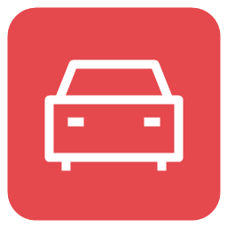

<p align="left">
  
  
</p>
<br clear="both">

# SlotForge Paddock

**Your slotcar collection, on display. Your workshop, organised.**

SlotForge Paddock is a desktop app for collecting, displaying, building and maintaining slotcars. Give each car a photograph and a place in your virtual showroom, or track every fitted part, setup change, workshop job and recorded lap.

Start with a name and a picture. Add detail when you need it. **The same app serves the casual collector and the dedicated tinkerer**, with local storage and optional sharing between your home or club computers.

[Download Paddock](https://github.com/theDutchmanJames/SlotForgePaddock/releases/latest) · [See the app](#pictures-of-the-app) · [Explore the features](#features-and-functionality) · [How to install](#how-to-install) · [Report a problem](#reporting-problems)

## SlotForge App Collection

SlotForge Paddock is part of the **SlotForge App Collection**—apps for building tracks, managing your cars, designing their appearance and exploring their performance.

-  **[SlotForge Timing](https://github.com/theDutchmanJames/SlotForgeTiming)** — Time laps, manage races and championships, and create custom race displays for analogue slotcar tracks.
-  **[SlotForge Telemetry](https://github.com/theDutchmanJames/SlotForgeTelemetry)** — Explore gearing, motors, tyres and weight, compare setups, and analyse recorded lap times.
-  **[SlotForge Decals](https://github.com/theDutchmanJames/SlotForgeDecals)** — Size and arrange artwork into decal sheets, then export a PDF for printing.
-  **[SlotForge Livery](https://github.com/theDutchmanJames/SlotForgeLivery)** — Plan paint schemes, stripes, race numbers and decals on editable 2D car templates.
-  **[SlotForge Circuit](https://github.com/theDutchmanJames/SlotForgeCircuit)** — Design slotcar tracks, including routed and FreeForm layouts, and export track data for Timing's Live Tracker.

Visit each app's repository for its features, downloads and getting-started guide. Circuit was previously called SlotForge Track Builder; its repository is now SlotForgeCircuit.

## Pictures of the app

<table>
  <tr>
    <th width="50%">Your Showroom · light theme</th>
    <th width="50%">Your Showroom · dark theme</th>
  </tr>
  <tr>
    <td><a href="docs/screenshots/showroom-light.png"></a></td>
    <td><a href="docs/screenshots/showroom-dark.png"></a></td>
  </tr>
</table>

*Your cars, your photographs, your collection. Click any screenshot for a closer look. These screenshots show an earlier interface with the SlotForge Database name; the app is now SlotForge Paddock.*

<details>
  <summary><strong>Explore the collection, workshop, parts and settings</strong></summary>

<table>
  <tr>
    <th width="50%">Your collection at a glance</th>
    <th width="50%">Browse and organise your cars</th>
  </tr>
  <tr>
    <td><a href="docs/screenshots/overview.png"></a></td>
    <td><a href="docs/screenshots/car-collection.png"></a></td>
  </tr>
</table>

<table>
  <tr>
    <th width="50%">Parts organised by category</th>
    <th width="50%">Build a car from your inventory</th>
  </tr>
  <tr>
    <td><a href="docs/screenshots/parts-categories.png"></a></td>
    <td><a href="docs/screenshots/build-from-scratch.png"></a></td>
  </tr>
</table>

<table>
  <tr>
    <th width="50%">Plan and resume workshop jobs</th>
    <th width="50%">Keep track of what needs attention</th>
  </tr>
  <tr>
    <td><a href="docs/screenshots/workshop-jobs.png"></a></td>
    <td><a href="docs/screenshots/review-hub.png"></a></td>
  </tr>
</table>

<table>
  <tr><th width="50%">Import, export and backups</th><th width="50%">Appearance settings</th></tr>
  <tr>
    <td><a href="docs/screenshots/import-export.png"></a></td>
    <td><a href="docs/screenshots/appearance-settings.png"></a></td>
  </tr>
</table>

</details>

## Features and functionality

### Your virtual slotcar showroom

**Add a car, add a photograph, enjoy your virtual garage.** Technical specifications are optional: you do not need an inventory or a racing setup to use Paddock.

Showroom gives your collection a photo gallery, a featured spotlight car, favourites and a slideshow. Create named **shelves** for selected cars and arrange them in your preferred order. Use full-screen presentation to display your collection at home or at the club. Choose Fit or Fill and adjust a photograph's focal point without changing the original image.

### Car profiles that grow with your hobby

Keep each car's identity, ownership and technical information together:

- Record manufacturer, model, scale, race number, class and identifying details.
- Track location, condition, packaging, purchase information, valuation and loans.
- Attach photographs and documents, and follow the car's recorded history.
- Label cars for **Collection / Display**, **Home racing**, **Club racing**, **Competition** or your own uses.
- Search and filter the collection, switch between gallery and table views, choose columns and save useful views.
- Sort by name, manufacturer, car brand, model, scale, product reference or dates added and changed, in either direction.
- Use **Select all** or **Select all results** to select matching cars across pages (up to 1,000 at a time).
- Choose which car details and configuration fields appear on the overview panels.

Previously entered values become reusable choices. Correct spellings and merge duplicates in **Library**, while historical snapshots retain their recorded values. Add custom text, choice, number, date, yes/no and notes fields when the built-in fields are not enough.

### Compare two cars

Open **Compare** on a car profile, or **Compare cars…** on the Cars page. Choose two cars, then open a side-by-side comparison of their identity, current technical specifications, gearing and custom fields. Highlight differences or hide matching details. Cars do not need recorded laps to be compared.

Optionally choose a recorded run for each car to compare reported manual bests or measured Timing pace. The comparison shows the configuration captured with each run, separately from today's specifications, and warns when track, lane, driver or conditions differ or are unknown.

### Parts inventory, catalogue and shopping list

**Know what you own, where it is and what is fitted.** Browse parts through main groups covering bodywork, chassis, motors, transmission, axles, bearings, wheels, tyres, guides, wiring, suspension and fixings.

| View | Purpose |
| --- | --- |
| **My stock** | Your owned part records, including parts fitted to cars or held in assemblies. |
| **Catalogue** | Your full list of part references, including products you do not own yet. |
| **Shopping list** | Planned purchases, suppliers, expected dates and quantities still to receive. |

Track quantities or individual components, storage locations, specifications, compatibility notes and photographs. Part icons default to their category; choose a different icon and one of five preset colours for your own organisation scheme.

Link purchases to workshop jobs and receive deliveries in stages. Receiving parts updates stock; fitting them to a car is a separate action. The overview counts **owned part types**, with individual quantities shown separately.

Manage the same product records from **Library → Parts catalogue**, with search, manufacturer and category filters, and a compact editable table. New catalogue entries start at zero owned stock. Select entries across pages and review a bulk deletion: owned parts and records linked to installations, setups, jobs, purchase history or saved build drafts are kept.

### Assemblies and Build from Scratch

An **assembly** groups components into a ready-to-use unit, such as a rear axle with wheels and gearing. Install, remove or transfer the unit, or replace its components while retaining their history.

**Build from Scratch plans a car from stock or catalogue parts.** Open it directly from the main menu, between Parts and Workshop. Click a component on the exploded chassis diagram, choose the part to fit there, and continue with whichever components you have. Additional positions support items such as bodywork, electronics, magnets and ballast.

**Rebuild a car without losing its story.** Start from a car's More menu, Build from Scratch or a Rebuild Workshop job. Choose fitted parts to reuse and add replacements. Completing the rebuild returns unused components to stock, creates a new car and links both profiles with **Rebuilt as / Rebuilt from** cards. The archived original keeps its photos, setups, work history and race results; new work belongs to its successor. Drafts leave inventory unchanged until completion. [How rebuilds work](docs/REBUILDS.md).

Only a name and **one component** are needed to save a car. Use **Save plan & update shopping** to save unfinished builds and add missing quantities to the shopping list, linked to that build. Receive purchases into stock before creating the physical car with an optional **As built** setup snapshot. Stock remains available while drafting and is fitted when the build is saved to Cars. The diagram supports planning; it does not certify physical compatibility.

### Gearing, torque and theoretical performance

**Explore a change before reaching for the tools.** The Build from Scratch calculator works with pinion and driven-gear teeth, motor RPM, torque ratings, test voltages and rear tyre diameter. Enter only the information you have.

| Calculation | What it helps you understand |
| --- | --- |
| **Gear ratio** | Driven-gear teeth ÷ pinion teeth. A 9-tooth pinion and 27-tooth crown give **3.00:1**. |
| **Axle RPM** | Rear-axle speed at the motor's specified no-load RPM. |
| **Rollout** | Distance travelled per motor revolution for the selected gearing and tyre diameter. |
| **Theoretical speed** | Ideal no-load speed from motor RPM, gearing and rear tyres. |
| **Axle torque and driving force** | How gearing and tyre diameter translate a confirmed motor torque rating into force at the track. |
| **Torque and power curves** | Explore operating points and estimated peak mechanical power for a brushed DC motor with confirmed stall torque and matching rating voltages. |

Keep a calculation as a reference, change the inputs and compare the results. Drafts preserve both the inputs and reference; saved cars and optional As built snapshots retain their entered specifications.

Torque uses **gf·cm**—gram-force centimetres. These are ideal estimates, not predictions of lap time, acceleration or actual top speed. Stall torque and no-load speed occur at different operating points. [Formulas, assumptions and a worked example](docs/THEORETICAL-PERFORMANCE.md).

### Setups, changes and workshop jobs

Keep the current configuration alongside factory reference information and named setup snapshots. Compare two saved setups, or a setup with the current car, showing technical specifications and tracked parts separately. Filter to differences and review stock needs, substitutions and transfers before applying a setup.

Create a **Workshop job** for maintenance, a modification or a planned setup change:

- Choose a category: General Work, Maintenance, Upgrades, Overhaul, Rebuild, Chassis, Tyres, Motor, Braids, Balancing, Front Assembly, Rear Assembly or Bodywork. Categories have labelled colour badges and a Workshop filter.
- Use either a free-form plan or a saved setup target with any category.
- Set priority, a target date and a checklist.
- Mark a job **Waiting for parts** and link its shopping items.
- Add before/after photographs and record progress.
- Leave and resume work, then complete or cancel the job.

Use **Record work** for maintenance or modifications already performed. Set future maintenance dates to create reminders. Workshop supplies provide a digital toolbox for tools, oils, cleaners, adhesives and other consumables, with locations, remaining amounts and low-stock thresholds.

### Manuals and Part Guides

Turn **Workshop → Manuals and Part Guides** into a reference wall for exploded views, part-number sheets and manufacturer catalogues. Upload a PDF or image, give it a name, and link it to a car—or keep it in the general reference library. Search by name or filename and filter by car.

Images appear as poster previews; PDFs have a labelled cover. Click either to open the original in your default image or PDF application. Rename, reassign, export a copy or remove a guide whenever needed. Originals stay unchanged in the collection and are included in complete backups; they are excluded from public car exports and Timing/Telemetry catalogue views. Dealership copies share routine guide changes directly.

Supported files: PDF, PNG, JPEG and WebP, up to 20 MiB each locally. Dealership uploads must also fit its existing 16 MiB request limit, including base64 encoding and command metadata. PDFs open externally; changes made in that external application do not replace the saved original.

### Track tests, lap records and pace comparisons

Record a manual test with its track, lane, driver, voltage, direction, magnet status, lap count and best or average time. Keep the configuration snapshot that describes the car at that test.

Imported **SlotForge Timing** sessions add measured lap histories and the configuration captured before racing. Later changes to the car do not rewrite those historical specifications. Corrections replace earlier results; withdrawn sessions stop contributing to derived statistics.

- **Lane records:** find the fastest eligible measured lap for each track and lane, with its driver, session and captured configuration. Reported manual bests are shown separately.
- **Compare pace:** choose two sessions from the same car or different cars. Filter by track name, lane and driver, then compare average and median pace, consistency, eligible best laps and uninterrupted 5/10-lap runs. Captured setup differences appear beside the results; missing evidence and differing conditions stay visible.
- **Find similar pace:** the existing manual/earlier Timing run finder remains available from Compare pace. Find cars within a chosen time tolerance on the same track.
- **Compare fairly:** use lane and driver filters, inspect recorded conditions and keep unknown conditions visible. Invalid laps, pit laps and virtual participants do not become physical-car records.

These tools compare recorded performance; they do not infer pace from motor specifications. For deeper analysis across sessions and setups, use **SlotForge Telemetry**. [History, conditions and comparison details](docs/REAL-CAR-HISTORY-AND-PACE.md).

### Research the exact slotcar product

Open **Car → Technical & parts → Research this slotcar**, or **More → Research slotcar…**. Set the slotcar manufacturer and complete product reference first, then download a car-specific English template for your own AI. Model, scale, livery and edition help cross-check the exact product; reference suffixes matter.

Import the completed JSON and review each sourced suggestion. Ambiguous identification and mismatched manufacturer, reference or scale are rejected. Selected original specifications go to **Factory reference**. For a car with no current specifications or fitted inventory, an optional checkbox initialises its current configuration too. Existing modifications remain separate. Sources and uncertainty are kept in factory technical notes. Paddock has no built-in AI, and a claimed exact match still needs your check against the source and product box.

[Slotcar research template and import guide](docs/SLOTCAR-RESEARCH.md).

### The real car behind the model

**Real Car History** records the full-size car or race entry represented by your slotcar: livery classification, team, drivers, event, year, race number, qualifying and finishing results, notes, sources and reference photographs.

Enter the information yourself, read labelled facts from a public webpage, or download a car-specific research template for your own AI to fill. Import the completed JSON and choose individual suggestions before saving. Source links and uncertainty stay with imported research.

Paddock has **no built-in AI**. Its generic webpage reader does not translate pages, execute website scripts or guarantee accurate identification of the car. Both research routes require your review; reference photographs remain separate from your slotcar's showroom pictures.

### Manufacturer catalogues without manual retyping

Download the **English catalogue import kit**, which includes supported part and workshop-supply categories, classification examples and instructions. Give it to your own AI with your chosen manufacturer or retailer sources, then import the completed JSON into Paddock.

Review the file and select the categories or products you want. New references start at **zero owned stock**; a manufacturer's pack size is not a quantity you own. Paddock validates the file and helps identify duplicates, but you still check product facts and compatibility. It does not scrape a manufacturer's entire website automatically. [Catalogue import guide](docs/CATALOGUE-IMPORT.md).

### Paddock Portal: add cars from your phone or tablet

Turn on **Connections → Paddock Portal**, then scan its QR code on your phone or tablet while connected to the same network. Enter the manufacturer and model, optionally add a product reference, and choose a photograph from your gallery or take one with the camera. **Send to Paddock** saves the car directly with that main photo, confirms success and prepares the next entry. Complete the remaining details later in Paddock.

Already have the car? Choose **Existing Car**, find it by name, manufacturer, model or reference, and upload up to **five additional photos** at a time. Preview and remove photos before sending. They are added to its gallery without changing the main photo; after confirmation, you return to the Portal main page.

Supported original photographs are preserved without resizing; oversized photos offer an explicit smaller-copy option. You can also type the displayed address and short access code. Turn the Portal off when finished. [Photo formats, limits and connection guide](docs/PADDOCK-PORTAL.md).

### Dealership Mode: one collection across your computers

Use the same Paddock app on a main computer, laptop and other trusted home or club computers. **One dealership computer holds the official collection**; connected copies keep a separate saved copy, leaving their personal collections separate.

Choose a remembered password in **Connections → Dealership Mode**. Connected Paddock copies receive incremental updates. Everyday changes save directly: car details, preferences, inventory, Workshop jobs, shopping and build plans. New cars, completed builds, saved setup changes, bulk operations and permanent car deletions enter **Review → Dealership changes**. Compare and approve those important changes on the dealership computer.

If a copy has fallen too far behind, Paddock asks for a backed-up refresh rather than silently merging incompatible changes. Joining a dealership does not merge existing personal databases.

**Dealership access shares the full collection, including private records, stock, jobs and documents.** Use it between trusted computers on a local network. The dealership app must remain running; this is not a cloud or remote-internet service. [Connection, review and recovery guide](docs/SHARED-CLUB.md).

### Connect Timing and Telemetry

In **SlotForge Timing**, connect to Paddock's current host address and port using the Dealership password. Select catalogue cars for racing, then send finalised results back to Paddock. Timing retains its racing cache and queues transfers when disconnected. Results already reviewed in Timing are stored directly; they do not need a second Dealership approval.

**SlotForge Telemetry** can read delivered sessions, measured laps and captured configurations from Paddock for analysis. Corrections and withdrawals are available to connected analysis clients. These integrations keep race execution in Timing, collection management in Paddock and deeper calculations in Telemetry.


### One shared library on the same computer

Compatible versions of Paddock and Timing use **the same local SQLite library** under the same operating-system account. Existing cars and supported racing history are adopted with their original identities preserved. Either app can read and write while the other is closed; opening it later shows the updated collection. This does not require Dealership Mode, an address, a password or a running Paddock background service.

Timing keeps live race recording, recovery and app-specific settings. Recorded history retains the car and configuration evidence available at the time; unknown historical details are not invented. Existing network and older local-service connections remain separate compatibility options. [Shared local library details](docs/SHARED-LOCAL-FOLDER.md).

### Merge duplicate cars without losing information

Choose **Car → More → Merge duplicate car**, or open **Review → Car merges**. Choose the main car, then select which details, photos, setups and racing history to include. Select all within a section or untick individual entries; every merge stays pending until you approve it.

The retired car's complete original information is preserved in a read-only archive. Late-arriving old-car history receives a separate inclusion review. Excluded history remains historical evidence and does not contribute to the main car; original overall Timing records remain intact. Installed parts and source-specific Timing settings have explicit reconciliation choices.

### Share selected cars, review imports and protect your collection

Export one or several cars as a Paddock JSON package, with optional additional photographs and setup snapshots. Send the file yourself; the recipient can import and review it without a network connection. Paddock also reads supported Timing car exports and can export supported car details, race classes and photographs in **SlotForge Timing format**.

For lighter sharing, the separate local-network sharing tools let another Paddock browse public car information and submit new cars or updates for review. These public views and car packages exclude private ownership details, private notes, workshop records and unrelated documents. They are different from the full trusted copy shared by Dealership Mode.

In **Review → Incoming cars**, choose individual incoming fields. If an accepted technical change conflicts with a fitted inventory part, explicitly return that part to stock before applying the new specification. Unselected fields stay unchanged; entering a replacement specification does not automatically fit a different stock item.

Create a **complete portable backup** for recovery or moving a personal collection to another computer. Backups preserve original photographs and documents, run with progress and cancellation, and include private collection information. Restores verify the file and save a recovery backup before committing. Existing JSON backups remain supported. [Backup and recovery details](docs/PORTABLE-BACKUPS.md). Restoring replaces the selected database; use selected-car imports when you only want to add entries. [Timing file-transfer guide](docs/TIMING-CAR-EXPORT.md).

Collections are stored locally in **SQLite**, with transactional saves and separately stored original photographs. Existing JSON databases migrate automatically after validation; the original file is retained. Galleries load smaller previews, while the photo viewer, exports and backups retain full-resolution originals. **Settings → Database → Export previous revision** provides an additional recovery option. [Storage and migration details](docs/SQLITE-STORAGE.md). Settings also shows database and media usage; see [current storage limits](docs/STORAGE-LIMITS.md).

### Delete a car or start a fresh collection

Use **Car profile → More → Permanently delete car…** to remove a car and its attached documents, setups, manual tests, workshop jobs and history. Type its exact name and confirm. Fitted loose parts return to Used spares; complete assemblies return intact to Used assemblies. Shared Timing sessions remain historical evidence, preserving other cars' results. Existing backups and received car packages are retained. In Dealership Mode, deletion is a proposal until approved.

Use **Settings → Database → Reset database…** to start empty. Paddock requires you to type **RESET**, then saves and verifies a complete recovery backup before proceeding. If the backup fails, the collection stays intact. Reset is available on a personal database or the authoritative dealership computer, not a connected copy.

The fresh collection receives a new identity and sharing stops. Reconnect Timing, Telemetry and Dealership copies to this new collection before importing fresh data. Old queued results cannot silently enter it. This resets the active collection; it does not erase external exports, recovery backups or other computers' copies.

### Reports, personalisation and everyday use

Produce **car cards**, **setup sheets**, **club scrutineering sheets** and a **collection inventory** through **Cars → Print / PDF**. Preview the report and save a PDF for printing. Purchase details are excluded unless explicitly selected. Car-card QR links open the matching collection in Paddock; they are not public web pages.

Choose from eight preset themes or create your own colours. Under **Settings → Appearance**, set **Interface size** from 80% to 200% to resize text, buttons and menus together, or reset to 100%. Interface size is saved on this computer independently of your collections. Edit the welcome banner, choose overview fields and save collection views. The **Review** button brings incoming cars, Dealership proposals, workshop jobs and maintenance reminders within reach.

Everyday personal collection and workshop use works offline. A new collection starts empty, ready for **your** cars, photographs and parts. [Guide to planning, reports and showroom shelves](docs/COLLECTION-PLANNING.md).

## How to install

Open the **[latest GitHub release](https://github.com/theDutchmanJames/SlotForgePaddock/releases/latest)** and expand **Assets** to see the downloads. Choose a packaged app for your computer; you do not need Node.js or programming tools. GitHub's **Source code** ZIP and tar.gz files are for building the app yourself.

| Your computer | Download | Open or install |
| --- | --- | --- |
| **Windows · Intel/AMD 64-bit** | `SlotForge.Paddock.…exe` | Save the portable executable in a folder you want to keep, then double-click it. |
| **macOS · Intel or Apple Silicon** | Universal `.dmg` | Open the disk image and drag Paddock into Applications. A ZIP of the app is also available. |
| **Linux · Ubuntu/Debian** | `.deb` matching your processor | Open it with your software installer, then launch Paddock from your applications menu. |
| **Linux · other compatible distributions** | `.AppImage` matching your processor | Allow the file to run as a program in its permissions, then open it. |

Linux packages target x64 and ARM64. Linux and macOS downloads are attached after the native build jobs succeed; if they are not listed yet, check the [build status](https://github.com/theDutchmanJames/SlotForgePaddock/actions/workflows/native-release.yml).

Windows downloads are unsigned. macOS downloads are ad-hoc signed, not Apple-notarised. Your operating system may ask you to approve the app; verify that it came from this repository. SHA-256 manifests accompany the release assets for integrity checks.

### Your first collection

1. Open **Cars → Add car** and enter a name.
2. Add a photograph in **Photos & documents**.
3. Open **Showroom** to see your collection on display.
4. Add parts, setups and workshop jobs whenever you want more detail.

### Updating and moving to another computer

Make a complete backup through **Import & Export**, close the running app and open the new version. Your collection is stored separately in your operating-system user profile. Moving or replacing the executable does not move the collection; use the backup/export tools to transfer your data. For a Dealership collection, follow its [recovery guidance](docs/SHARED-CLUB.md).

### Run or build from source

Install Node.js **24 or newer** with npm, download and extract the source, then open a terminal in the folder containing `package.json`:

```sh
npm ci
npm start
```

On Windows, use `npm.cmd` if PowerShell blocks `npm.ps1`. After installing dependencies, `Start SlotForge.cmd` is also available.

For your own installers, see [Building installers](docs/BUILDING.md). Contributor commands and implementation notes are in [Development](docs/DEVELOPMENT.md).

## Reporting problems

Open an **[issue on GitHub](https://github.com/theDutchmanJames/SlotForgePaddock/issues)** and include:

- Paddock version, operating system and the download you used.
- What you were doing, what you expected and what happened instead.
- Steps to reproduce the problem, the exact error and a screenshot if useful.
- For connection issues: which app/computer is hosting, the connected app versions and whether the issue affects browsing, submitting changes or receiving results.

Do not post passwords or an unredacted collection backup. A small example with private details removed is more useful for reproducing a problem. Feature suggestions are welcome too—describe the task you want to make easier.

## License and copyright

Copyright © 2026 **theDutchmanJames and contributors**. SlotForge Paddock uses the **[SlotForge Source-Available License 1.0](LICENSE)**.

- **Free to use** for personal, educational, club and internal business use.
- **Free to study, modify and share without charging**, retaining the licence and notices and identifying modifications.
- **No selling the software or charging for access**, including modified, bundled or hosted versions, without separate written permission from the relevant copyright holders.
- **Your own original content can be used commercially**, including collection records, photographs and reports, subject to any third-party rights.
- Voluntary donations are allowed when access and use do not depend on payment.

These are custom **source-available** terms, not an OSI-approved open-source licence. The [full licence](LICENSE) governs use. Electron and other dependencies retain their [own licences and notices](THIRD-PARTY-NOTICES.txt).
