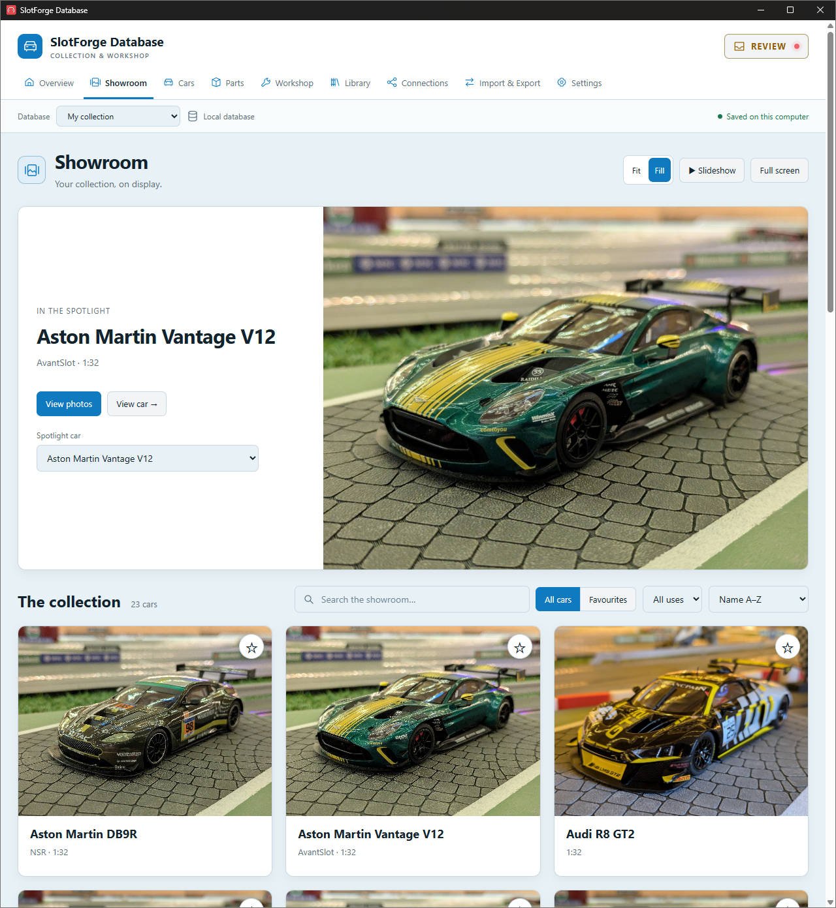
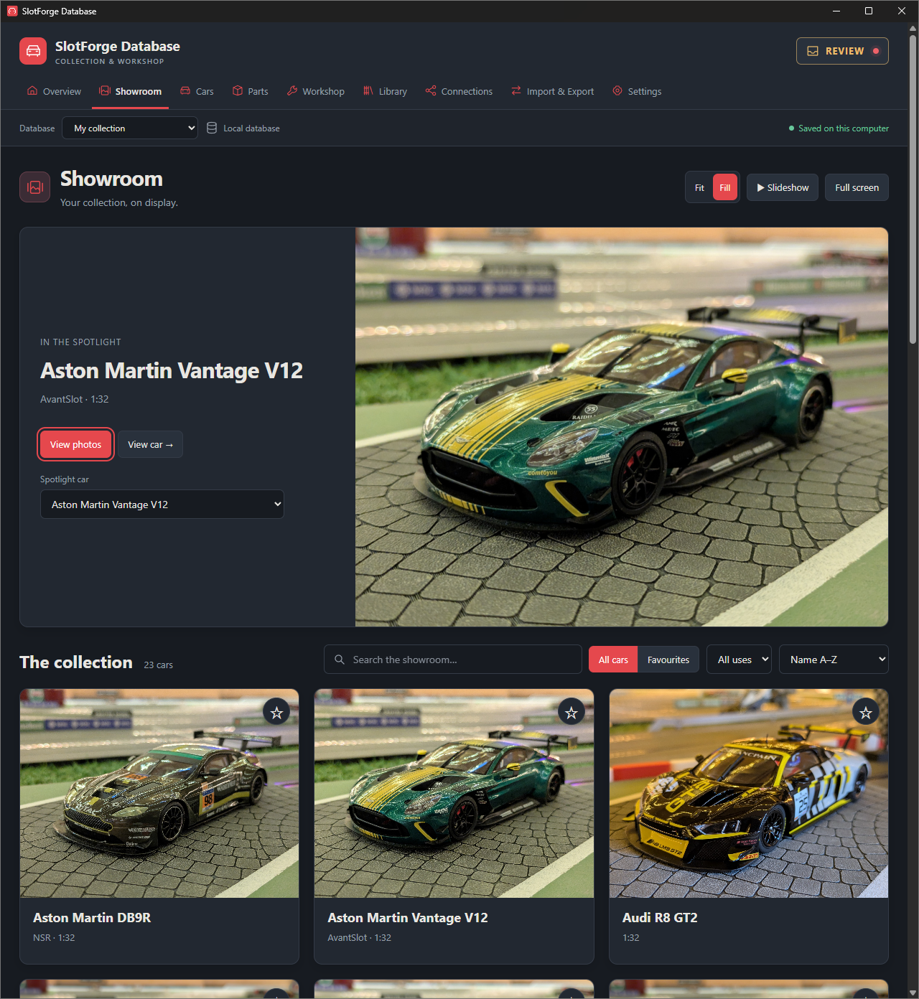
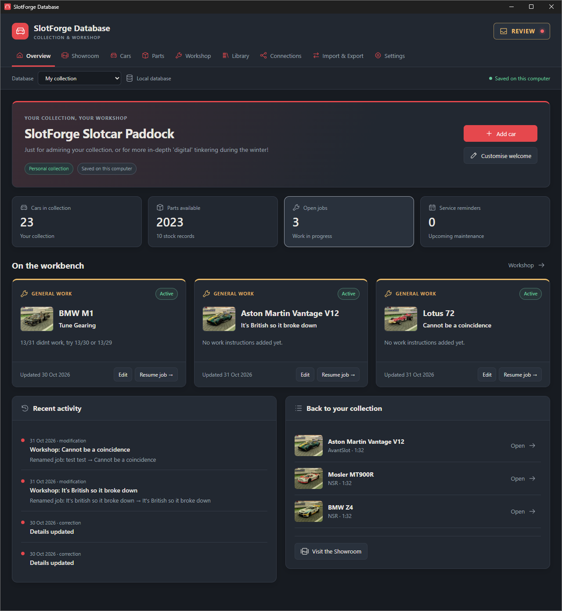
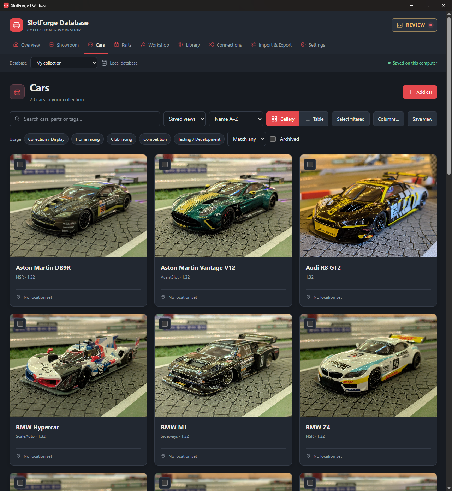
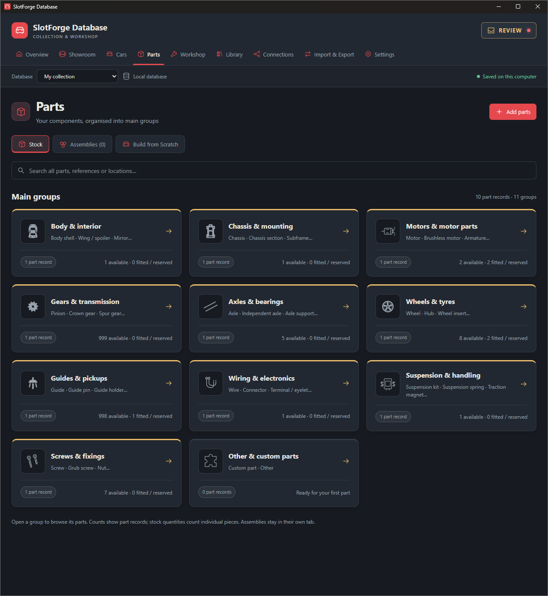
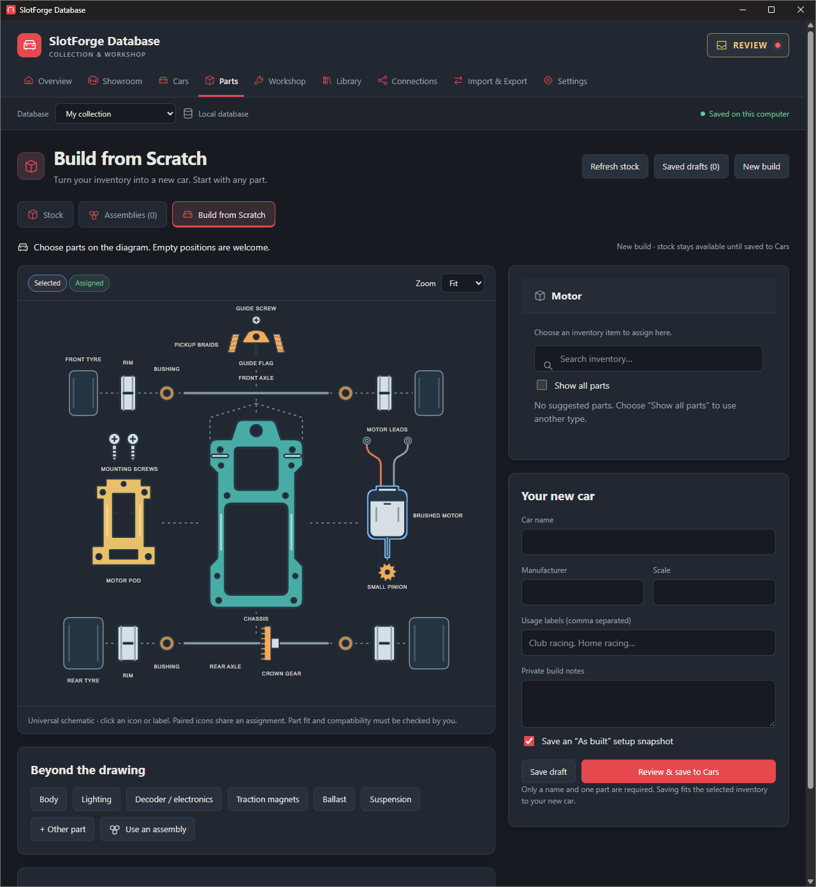
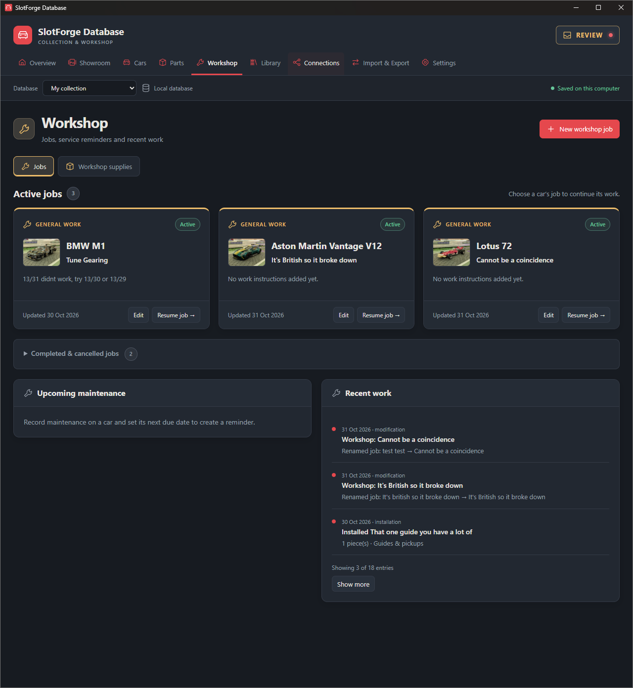
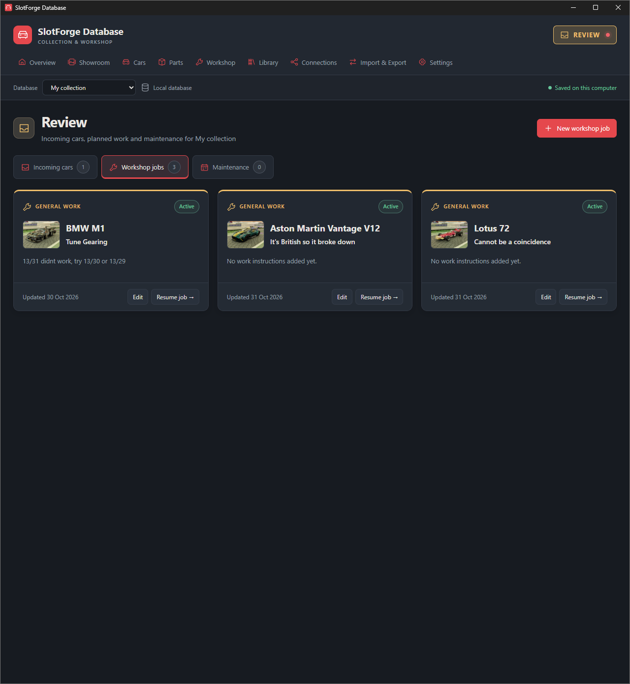
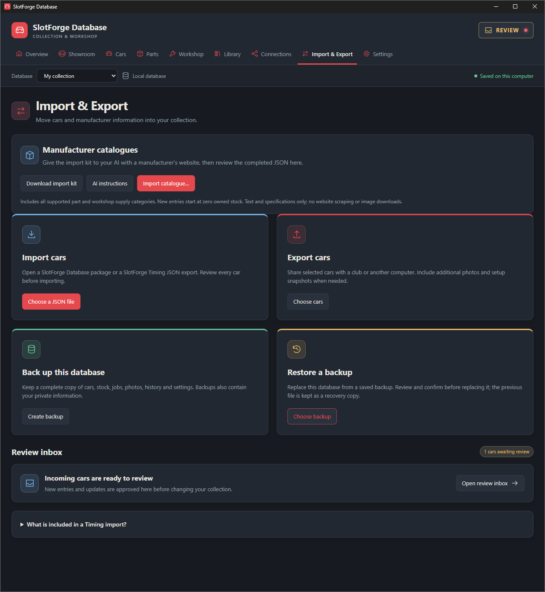
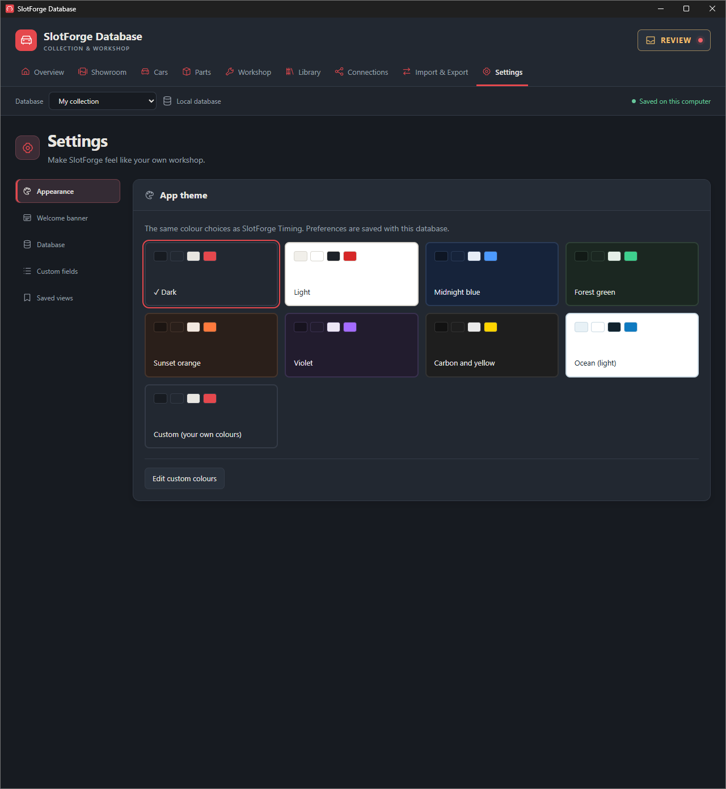

# SlotForge Paddock

**Your virtual slotcar garage. Your detailed workshop. One collection.**

<table>
  <tr>
    <th width="50%">Your Showroom · light theme</th>
    <th width="50%">Your Showroom · dark theme</th>
  </tr>
  <tr>
    <td><a href="docs/screenshots/showroom-light.png"></a></td>
    <td><a href="docs/screenshots/showroom-dark.png"></a></td>
  </tr>
</table>

*Your own cars, your own photographs. Click any screenshot to view it at full size. These screenshots show the earlier SlotForge Database branding.*

SlotForge Paddock is a desktop app for collecting, displaying, building and maintaining slotcars. Add a car and a photograph to start your virtual showroom, or go deeper into parts, setups, maintenance and racing preparation.

Both approaches use the same collection. **You decide how much detail to record.**

[Virtual showroom](#for-the-collector-your-virtual-showroom) · [Detailed workshop](#for-the-tinkerer-your-detailed-slotcar-workshop) · [Club sharing](#connect-with-your-club) · [Getting started](#getting-started) · [Project status](#project-status)

## For the collector: your virtual showroom

*Add a car, upload a photograph, and enjoy your own digital slotcar garage.*

You don't need to enter technical specifications or manage spare parts to get started.

- **Display your collection.** Showroom presents your cars in a photo gallery, with a featured spotlight car, favourites, full-screen viewing and a slideshow.
- **Build a profile for each car.** Start with its name and photograph, then optionally add manufacturer, scale, model, livery, racing number and other identifying details.
- **Keep your collection organised.** Search, filter and label cars—for example, Collection / Display, Home racing, Club racing or Competition.
- **Record ownership details.** Keep track of storage locations, condition, packaging, purchases, valuations and loans.
- **Keep photographs and documents together.** Add extra pictures and attach relevant paperwork to each car.
- **Choose how you browse.** Switch between gallery and table views, customise table columns and save frequently used views.
- **Make it feel like your garage.** Choose a colour theme, customise the three-line welcome banner and select which information appears on car overview panels.

You can stop here and have a useful collection app. The workshop features are available whenever you want them.

<table>
  <tr>
    <th width="50%">Your collection at a glance</th>
    <th width="50%">Browse and organise your cars</th>
  </tr>
  <tr>
    <td><a href="docs/screenshots/overview.png"></a></td>
    <td><a href="docs/screenshots/car-collection.png"></a></td>
  </tr>
</table>

## For the tinkerer: your detailed slotcar workshop

*Know what is fitted, what you changed, what worked and what you want to try next.*

The same car profiles can hold detailed technical records and connect directly to your parts inventory.

### Configurations and setups

- **Record detailed configurations.** Document motors, motor pods, gearing, axles, bearings, wheels, tyres, guides, braids, electronics, ballast and more. Keep current specifications alongside factory reference information.
- **Calculate gearing automatically.** Enter pinion and driven-gear tooth counts to see the ratio.
- **Save and compare setups.** Capture configurations with names, track information and notes. Review changes before applying a saved setup, including required stock, substitutions and transfers from other cars.
- **Record testing results.** Manually log track tests and lap statistics against setup snapshots to relate performance to configuration changes.

### Parts, assemblies and new builds

- **Manage spare parts.** Browse stock by category, track quantities or individual items, and see what is available, fitted or reserved. Store specifications, locations, photographs and compatibility notes.
- **Choose icons and colours.** Use automatic part-type icons or pick your own, with five preset colours for your preferred organisation scheme.
- **Build assemblies.** Combine components into a ready-to-use unit, such as a complete rear axle or motor-pod assembly. Install, remove, transfer or replace its components while retaining their history.
- **Build from Scratch.** Click parts on the exploded SVG diagram to assign inventory to a new car. Highlights follow the component shapes. Save unfinished drafts, or create a car with as little as one component. An optional **As built** setup records its starting configuration.
- **Import manufacturer catalogues.** Download an AI-ready template containing the supported part and workshop-supply categories. Give it to your own AI with chosen manufacturer or retailer sources, then review the completed file and select which products to import. New entries start at **zero owned stock**; pack sizes do not become owned quantities.

<table>
  <tr>
    <th width="50%">Parts organised by category</th>
    <th width="50%">Build a car from your inventory</th>
  </tr>
  <tr>
    <td><a href="docs/screenshots/parts-categories.png"></a></td>
    <td><a href="docs/screenshots/build-from-scratch.png"></a></td>
  </tr>
</table>

### Jobs, maintenance and your digital toolbox

- **Plan workshop jobs.** Create maintenance or modification jobs, or work towards a saved setup in stages. Edit job details, record progress, leave and resume work, then complete or cancel it.
- **Keep a work history.** Record completed maintenance and modifications, set future maintenance dates and see what changed over time.
- **Maintain a digital toolbox.** Track tools, oils, cleaners, adhesives and other workshop supplies, including storage locations, remaining amounts and low-stock thresholds.
- **See what needs attention.** The **REVIEW** button brings incoming cars, workshop jobs and maintenance reminders together in one place.

<table>
  <tr>
    <th width="50%">Plan and resume workshop jobs</th>
    <th width="50%">Keep track of what needs attention</th>
  </tr>
  <tr>
    <td><a href="docs/screenshots/workshop-jobs.png"></a></td>
    <td><a href="docs/screenshots/review-hub.png"></a></td>
  </tr>
</table>

## Connect with your club

The same app works for personal and club collections—there is no separate host or client edition.

- **Browse a shared collection.** Connect to another running instance over a local network using its connection code. Shared car information refreshes automatically while connected.
- **Submit cars for approval.** Prepare an entry at home, then send it to the club when connected. The host reviews incoming submissions before accepting new cars or changes; members do not directly edit the host's records.
- **Exchange files instead.** Export selected cars to JSON, send the file yourself, and let the recipient import and review it. You don't need to bring your computer to the club.
- **Keep private records local.** Personal ownership information, private notes, workshop records and document attachments are excluded from car-sharing packages and shared views. Complete backups retain private data.

Local sharing requires the host app to remain running and both computers to be able to communicate. It is intended for a trusted local network, not public internet hosting.

<details>
  <summary><strong>See imports, exports and complete backups</strong></summary>
  <p>Bring in manufacturer catalogues and car files, export entries for your club, or keep a complete backup.</p>
  <a href="docs/screenshots/import-export.png"></a>
</details>

## Useful whichever way you use it

- **Reusable choices:** select previously entered values instead of repeatedly typing them. Correct or merge choices through the Library while preserving historical snapshots.
- **Flexible organisation:** use labels, custom fields, saved views and reviewed bulk updates to suit your collection.
- **Local storage:** everyday collection and workshop use works offline. A new collection starts empty, ready for your own cars and parts.
- **Complete backups:** back up and restore your collection, photographs, documents, inventory, setups and workshop records.
- **Personal appearance:** choose from eight preset themes or create a custom palette, with an interface inspired by SlotForge Timing.

<details>
  <summary><strong>Explore the themes and personalisation settings</strong></summary>
  <p>Choose a preset or create your own colours, then customise your welcome banner and collection views.</p>
  <a href="docs/screenshots/appearance-settings.png"></a>
</details>

## Getting started

1. Open **Cars → Add car** and give your car a name.
2. Add a photograph through **Photos & documents**.
3. Open **Showroom** and enjoy your collection.

When you want to go further, add spare parts in **Parts**, save a setup from a car profile, or create a job in **Workshop**. Technical detail is optional.

### Run on Windows

[Download the latest release](https://github.com/theDutchmanJames/SlotForgePaddock/releases/latest), then open **SlotForge Paddock 0.16.3.exe** from the release assets. It is portable and does not require Node.js. Close an earlier running copy before opening the updated version.

The Windows executable is unsigned, so Windows may show an unknown-publisher warning. A `SHA256SUMS.txt` file is included with the download for integrity checking. Your collection is stored separately in your Windows user profile; moving the executable does not move your collection. Use the app's backup and export features to transfer your data.

### Run from source

With Node.js and npm installed, run these commands in the project folder:

```sh
npm ci
npm start
```

On Windows, after installing dependencies, you can also use `Start SlotForge.cmd`.

To create the Windows portable build:

```sh
npm run dist
```

The current build is written to `dist/v0.16.3/`. Development notes, test commands, recovery information and release history are in [Development & release history](docs/DEVELOPMENT.md).

## Project status

Current version: **0.16.3**. The project is under active development. **SlotForge Paddock** is the official name; earlier versions were called SlotForge Database.

| Feature | Status |
| --- | --- |
| Collection, Showroom, parts, setups and workshop tools | Available |
| Build from Scratch and manufacturer catalogue imports | Available |
| Local-network browsing and reviewed submissions | Implemented; physical two-computer Wi-Fi testing remains outstanding |
| SlotForge Timing car imports | Available through supported Timing JSON exports |
| Live SlotForge Timing / RaceCoordinatorAI synchronisation | Planned |
| Automatic lap-data exchange | Planned; performance records currently use manual entry |
| Windows portable build | Built and tested |
| Native macOS and Linux builds | Build targets exist; native testing remains outstanding |

Catalogue imports validate structure and help identify duplicates. Manufacturer facts and physical part compatibility still need your review; the app does not scrape websites or download product images automatically.
