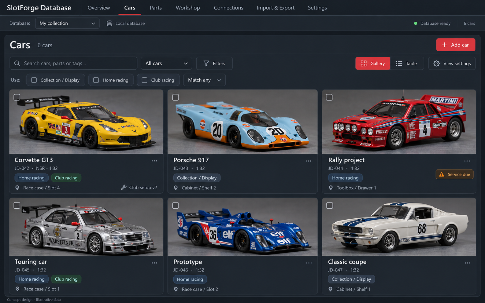
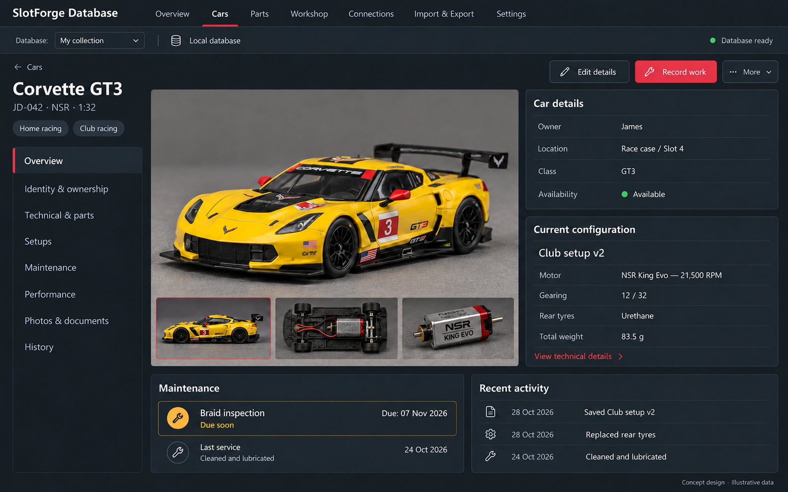
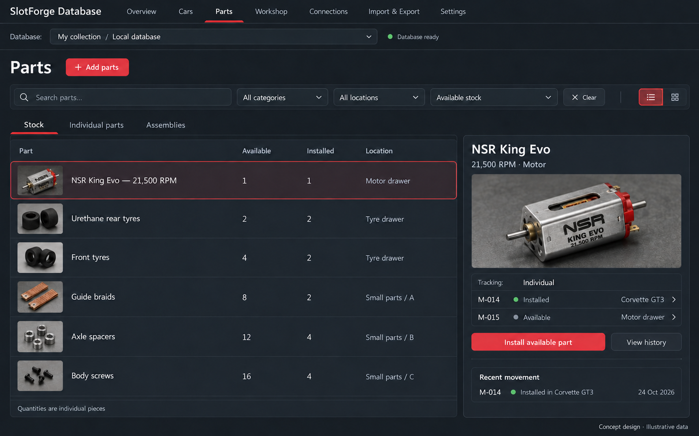
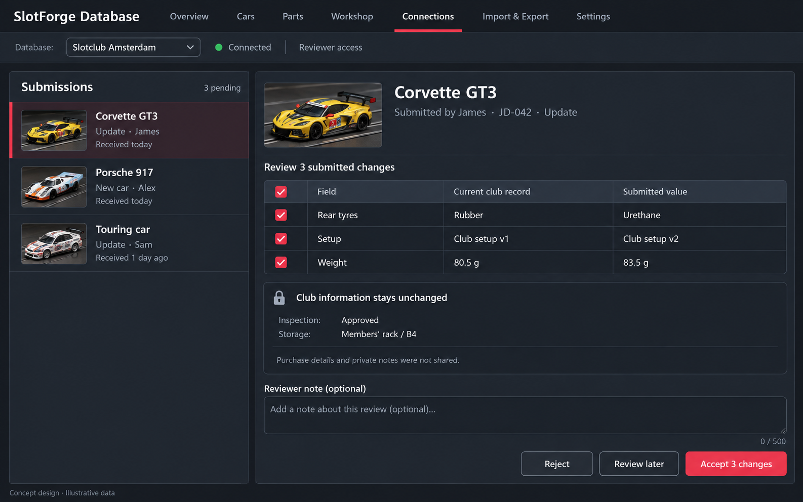

# SlotForge screen designs

These four static proposals explore the agreed desktop workflow using SlotForge Timing's dark theme. The name remains undecided; “SlotForge Database” is a placeholder. Cars, photos, specifications, dates and people shown are illustrative, not supplied collection data or verified product specifications.

The [consolidated concept](consolidated-concept.md) is the functional reference. [Generation prompts](design-prompts.md) preserve the design direction and targeted corrections. Built-in image generation was used; no application implementation was created.

## Cars

Photo gallery, searchable collection, usage filters, saved views and gallery/table switching. The pictured collection is demonstration content only; the actual app starts empty.

## Car profile

Photo, section navigation, current configuration, maintenance and recent history. The same layout also serves collection-only cars with unused sections unobtrusive.

## Parts inventory

Available and installed quantities are distinct. The selected motor type opens its individually tracked examples and current locations.

## Club submission review

The receiving club compares submitted changes, selects which to accept, and retains its own inspection and storage information.

## Visual decisions for the next review

Keep the shared horizontal main navigation, database context and red accent. Assess gallery density and photo size, the profile's photo-to-details balance, the parts detail panel, and review readability. Refine exact spacing, wording and control consistency when preparing implementable layouts. Light themes, table view, reusable-choice editing, setup comparison and the sender's sharing preview remain further screen-design work.
