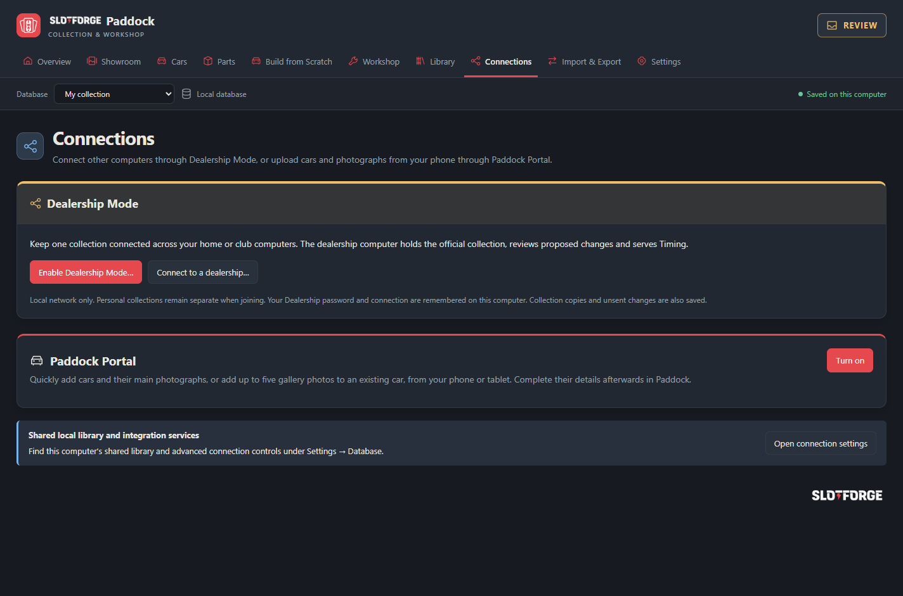

# Connections and shared libraries

Choose the workflow that matches where your data needs to go.

| Purpose | Where to find it | How it works |
| --- | --- | --- |
| Paddock and Timing on this computer | Settings → Database → Shared local library | Compatible apps use the same local file under the same OS account. No address, password or running Paddock service is needed. |
| A collection across trusted computers | Connections → Dealership Mode | One computer hosts; other Paddock installations keep separate replicas. Timing and Telemetry use the host's integration APIs. |
| Photographs from a phone or tablet | Connections → Paddock Portal | Temporarily enable the mobile webpage, then scan its QR code on the same network. |
| Send selected cars as a file | Import & Export | Export JSON, then review the received package before importing. |

The shared-library panel identifies this computer's own library even when you are viewing a downloaded Dealership copy. The selected copy is shown separately. A path or identity does not indicate whether Timing is currently running.

## Existing connections remain available

Under **Settings → Database → Advanced integration services**:

- **Local integration service** retains the independent same-computer HTTP connection used by compatible integration clients. Its enable/retry controls do not enable LAN hosting. Disabling it removes its automatic background-start registration, but does not disable direct shared-file access.
- **Older sharing connections** appears when there is an active public connection, legacy host or pending submission. Manage its original codes/passwords, public view, refresh and retry controls here.
- **Recover an older connection…** makes those controls available after explicit confirmation when no active connection remains. Opening the controls starts no service and changes no permissions. Credentials and public snapshots from older app sessions were held in memory; ask the host for its current address and code.

An existing browse-only or Timing-results credential still has its original permissions. It is not silently converted into full Dealership access. If broader access is inappropriate, keep using the compatibility controls.

## Migrate an existing host

1. Resolve any pending public submission or save its recovery file.
2. Open **Older sharing connections → Migrate to Dealership Mode…**. Enabling Dealership from Connections while legacy hosting is active opens this same migration dialog.
3. Check the collection identity, choose a Dealership password and explicitly approve sharing the full collection, including private records, stock, jobs and documents.
4. Paddock lets already admitted requests finish and makes a recovery backup before switching hosting. New requests can briefly receive a retryable service-unavailable response.
5. Reconnect affected Paddock, Timing and Telemetry clients using the **newly displayed address, port and password**. Verify the same database identity and retain pending deliveries and cached racing data.
6. Once the clients and pending deliveries have been checked, acknowledge the reconnection guidance on Connections. It stays visible across restarts until you do.

Cancel leaves the old host unchanged. A backup failure leaves the old host usable. If Dealership settings are saved but its listener fails to start, use **Start Dealership** to retry. Paddock does not automatically restore the backup: shared-file users may have made newer changes. Migration preserves collection/car identities, race results and delivery receipts; it creates the separate Dealership identity needed for replication.

## Migrate an existing public browser

Choose **Join this host's Dealership…** from the older-connection controls. Ask the host for its Dealership address and password. Paddock checks that it is the **original database**, then downloads a separate full replica through the normal join process. Your personal library and existing public view remain separate. A public cache is never promoted into a writable replica.

## Save and recover an uncertain submission

**Submission awaiting acknowledgement** stays above the collapsed advanced controls. The host may already have received this package.

1. Use **Retry same submission** when connected to its original host. If viewing a Dealership copy, first use **Open personal collection**.
2. To close Paddock or migrate before delivery is resolved, choose **Save recovery file…**. Keep the file until the host acknowledges the package.
3. After restarting, use **Advanced integration services → Recover a pending submission → Open recovery file…**. Reconnect to the original host using its current credential, then retry.

Recovery retains the exact original package ID, content and destination identity, even if you later edit the local car. Loading it does not import cars or send anything automatically. Files contain public car data and optional photos, but no passwords; the original 32 MiB package bound applies. Closing Paddock with an unsaved pending package offers to keep the app open or save recovery before quitting.

**Discard retry copy** removes only the local retry. It does not withdraw a package already received; check the host's Incoming cars review. Packages already lost when an older app exited without saving cannot be reconstructed safely. Check the receiving inbox before creating a new package.

Dealership's durable proposal outbox and Timing's result queue remain separate. Do not replace either with a public-submission recovery file.

## Stopping services

**Stop Dealership** pauses network hosting. **Turn off Dealership Mode…** backs up and removes the mode. Neither disables the same-computer shared file. **Turn off** in Paddock Portal stops only the mobile page. Network and local HTTP clients need their Paddock service running; optional background mode keeps that process available when its window closes.

See [Dealership setup and recovery](SHARED-CLUB.md), [the shared local library](SHARED-LOCAL-FOLDER.md), [Paddock Portal](PADDOCK-PORTAL.md) and [portable backups](PORTABLE-BACKUPS.md).
